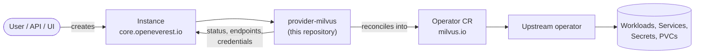

# Milvus Provider

> [!WARNING]
> **Pre-alpha.** OpenEverest v2 and this provider are under active development. CRD schemas,
> chart values and defaults change frequently, including in breaking ways, and there is no
> supported upgrade path between versions yet. Not for production use.

<!-- TODO(sdk): remove the pre-alpha banner and the status badge at v2 GA. -->

[](https://github.com/openeverest/openeverest)
[](https://github.com/openeverest/provider-milvus/actions/workflows/ci.yaml)
[](https://github.com/openeverest/provider-milvus/releases)
[](https://pkg.go.dev/github.com/openeverest/provider-milvus)
[](LICENSE)

Run **Milvus** on Kubernetes through [OpenEverest](https://github.com/openeverest/openeverest),
backed by the [Milvus Operator](https://github.com/zilliztech/milvus-operator).

## What this is

OpenEverest providers translate a single, technology-agnostic `Instance` custom resource into
the native custom resources of an upstream Kubernetes operator — for databases, but equally
for caches, message queues, object storage, or model-serving runtimes. This repository is the
provider for Milvus: it owns the technology-specific knowledge — topologies, versions,
parameters, backup wiring — so that users, the API server, and the UI stay technology-agnostic.

> [!IMPORTANT]
> **This provider is not standalone.** It requires an OpenEverest installation (core CRDs and
> controller) in the cluster. Installing this chart on its own does nothing.
> See [Install OpenEverest](https://openeverest.io/documentation/current/quick-install.html).



The provider watches `Instance` resources whose `spec.providerRef.name` is
`milvus`, and reports workload health back onto `Instance.status`. It never
manages pods directly — all lifecycle work is delegated to the operator.

## Compatibility

<!-- TODO(provider): keep this table accurate for every release. -->

| provider-milvus | OpenEverest | Operator | Kubernetes |
|---|---|---|---|
| `0.4.x` | `>= 2.0.0` | `1.3.11` | `1.30` – `1.36` |
| `0.3.x` | `>= 2.0.0` | `1.3.11` | `1.30` – `1.34` |
| `0.2.x` | `>= 2.0.0` | `1.3.9` | `1.30` – `1.34` |
| `0.1.x` | `>= 2.0.0` | `1.3.9` | `1.30` – `1.34` |

## Capabilities

What you can do to a running instance through the `Instance` API. Upgrading the
provider itself is covered under [Installation](#installation).

| Capability | Status | Notes |
|---|---|---|
| Provisioning | ✅ | Standalone and cluster topologies |
| Horizontal scaling | ✅ | Per-component replica counts; CPU/memory autoscaling for proxy, data and query nodes; scale-in is refused while a loaded collection needs the nodes |
| Vertical scaling (CPU / memory) | ✅ | Per-component resource limits |
| Version upgrades | ✅ | `spec.version`; the operator performs the rolling update |
| Custom configuration | ✅ | Milvus engine config via component `parameters.configuration` |
| Authentication | ✅ | A `root` credential is generated and published to the connection Secret |
| Network exposure | ✅ | ClusterIP, NodePort or LoadBalancer via the component `service` |
| Pod scheduling | ✅ | Per-component `schedulingPolicy` (affinity, tolerations, node selector, topology spread, scheduler); not applied to bundled dependencies |
| Pod customization | ✅ | Per-component `parameters.pod`: annotations, env, volumes, volume mounts, container security context, init containers |
| Monitoring | ✅ | Prometheus: a PodMonitor for the Milvus components via `topology.parameters.monitoring.prometheus`; requires the Prometheus Operator |
| Health checks | ✅ | `Ready` needs Milvus and its etcd, object storage and message stream healthy; reduced redundancy is reported in `status.message`; per-component probe tuning via `parameters.probes` |
| TLS | ❌ | |

Stateful workloads additionally report:

| Capability | Status | Notes |
|---|---|---|
| Persistent storage | ✅ | Bundled object storage (MinIO) sized via `topology.parameters.dependencies.storage.persistence.size`, or an OpenEverest storage location via `storage.backupStorageName`; Milvus components are stateless and take no `storage` |
| Storage expansion | ❌ | |
| Backups (on demand) | ✅ | `milvus-backup` BackupClass; runs the upstream [milvus-backup](https://github.com/zilliztech/milvus-backup) tool into an S3-compatible BackupStorage |
| Backups (scheduled) | ✅ | Cron schedules in `spec.backup`, run as CronJobs, with count- or time-based retention |
| Point-in-time recovery | ❌ | |
| Restore | ✅ | Into an existing instance or a new one (`spec.dataSource`); needs Milvus 2.6.12 or newer |

## Installation

The provider chart is published as an OCI artifact:

```bash
helm install provider-milvus \
  oci://ghcr.io/openeverest/charts/provider-milvus \
  --version <chart-version> \
  --namespace everest-system
```

- The Milvus operator is bundled as a chart dependency and is installed automatically.

Upgrade and uninstall:

```bash
helm upgrade provider-milvus oci://ghcr.io/openeverest/charts/provider-milvus
helm uninstall provider-milvus --namespace everest-system
```

Uninstalling the chart does **not** delete running `Instance` resources or their data.

Upgrading from `0.2.x` moves the bundled operator to 1.3.11. Milvus pods of
existing instances restart once; their bundled MinIO is left as is, while new
instances get its successor, Silo.

## Usage

Verify that the provider registered itself:

```bash
kubectl get providers.core.openeverest.io milvus
```

Create an instance:

```yaml
apiVersion: core.openeverest.io/v1alpha1
kind: Instance
metadata:
  name: milvus-standalone
spec:
  providerRef:
    name: milvus
  topology:
    type: standalone          # optional; standalone is the default
  components:
    standalone:
      type: milvus
      replicas: 1
      resources:
        limits:
          cpu: "1"
          memory: 4Gi
```

Component names are defined by this provider — see [definition/provider.yaml](definition/provider.yaml).
`spec.version` and `spec.topology` are optional; the provider defaults apply. More
examples (including a full cluster topology) live in [examples/](examples/).

Watch it come up:

```bash
kubectl get instance milvus-standalone -w
```

### Connect

Authentication is enabled by default. On first boot the provider generates a
random password for the built-in `root` user and publishes the connection
details to the Secret referenced by `.status.connectionSecretRef` (named
`milvus-standalone-conn`):

```bash
# host, port, username, password, uri and a ready-to-use root:<password> token
kubectl get secret milvus-standalone-conn \
  -o go-template='{{range $k,$v := .data}}{{$k}}={{$v | base64decode}}{{"\n"}}{{end}}'
```

From your workstation, port-forward the service and connect with pymilvus:

```bash
kubectl port-forward svc/milvus-standalone-milvus 19530:19530
```

```python
from pymilvus import MilvusClient

client = MilvusClient(uri="http://localhost:19530", token="root:<password>")
client.create_collection("demo", dimension=8)
```

### Rotate the root password

The root password lives in the `<instance>-credentials` Secret. Change its
`password` key and the provider updates the `root` user in Milvus once the
instance is healthy, then publishes the new password to the connection Secret:

```bash
kubectl patch secret milvus-standalone-credentials --type merge \
  -p '{"stringData":{"password":"<new-password>"}}'
```

Leave `appliedPassword` alone: it is the password Milvus currently accepts, and
the provider needs it to authenticate the change. Until the rotation lands,
the connection Secret keeps the old, working password.

### Expose it outside the cluster

Set the service type on the client-facing component (`standalone` for standalone,
`proxy` for cluster). The connection details then report the external address
automatically:

```yaml
spec:
  components:
    standalone:
      type: milvus
      service:
        serviceType: LoadBalancer   # or NodePort
```

- **ClusterIP** (default) — reachable only inside the cluster.
- **LoadBalancer** — the connection host is the load balancer address once assigned.
- **NodePort** — the connection host is a node address paired with the assigned node port.

### Customize component pods

`parameters.pod` adds pod-level settings to one component, e.g. to attach an
SR-IOV/RDMA secondary network to the query nodes:

```yaml
spec:
  components:
    queryNode:
      type: milvus
      resources:
        limits:
          nvidia.com/gpu: "1"
          rdma/hca: "1"
      parameters:
        pod:
          annotations:
            k8s.v1.cni.cncf.io/networks: sriov-rdma
          securityContext:
            capabilities:
              add: ["IPC_LOCK"]
```

`volumes`, `securityContext` and `initContainers` take Kubernetes objects and
are validated when the instance is reconciled.

### Split a component across node pools

`parameters.groups` runs `proxy`, `dataNode`, `queryNode` or `streamingNode` as
several independently placed workloads, e.g. query nodes on two GPU models.
Groups inherit the component's image, resources and pod settings; the
component's `replicas`, when set, must equal the groups' total:

```yaml
spec:
  components:
    queryNode:
      type: milvus
      replicas: 6
      parameters:
        groups:
          - name: l40s
            replicas: 4
            nodeSelector:
              nvidia.com/gpu.product: NVIDIA-L40S
          - name: h200
            replicas: 2
            nodeSelector:
              nvidia.com/gpu.product: NVIDIA-H200
```

### Scale and autoscale

Change a component's `replicas` to scale it; the standalone topology always
runs one replica. `parameters.autoscaling` on `proxy`, `dataNode` or
`queryNode` adds a HorizontalPodAutoscaler that keeps at least `replicas` pods
and adds up to `maxReplicas` under load. Targets are percentages of the
component's resource requests (its limits when no requests are set), so the
component needs CPU or memory resources; without a target it aims at 80% CPU.
Autoscaling cannot be combined with `groups`, and the Kubernetes metrics API
(metrics-server) must be available.

```yaml
spec:
  components:
    queryNode:
      type: milvus
      replicas: 2
      resources:
        limits:
          cpu: "2"
          memory: 8Gi
      parameters:
        autoscaling:
          maxReplicas: 6
          targetCPUUtilization: 70
```

Every replica of a loaded collection needs a query node and a streaming node
of its own. Lowering `queryNode` or `streamingNode` replicas (or the
autoscaling minimum) below the replica count of a loaded collection is
rejected; release the collection, or reload it with fewer replicas, first.

### Bring your own etcd and object storage

The simplest way to keep Milvus data outside the cluster is an OpenEverest
storage location (Settings → Storage locations, a `BackupStorage` of type
`s3`) in the instance's namespace. The provider takes its endpoint, bucket,
region and keys, and keeps the data under `rootPath` (default
`milvus/<namespace>/<instance>`), apart from backups in the same bucket. In the
UI, enter the location's name in **Object storage → Storage location**:

```yaml
spec:
  topology:
    parameters:
      dependencies:
        storage:
          backupStorageName: s3-prod
```

The keys are copied into the `<instance>-object-storage` Secret on every
reconcile; Milvus picks up rotated keys when its pods restart. Storage
locations with `verifyTLS: false` are rejected: Milvus always verifies TLS.

For anything a storage location can't express (cloud identity, Azure, a
provider-specific client), point Milvus at existing services directly. With
`useIAM` the pods authenticate through the ServiceAccount's cloud identity
(e.g. EKS IRSA); otherwise `credentialsSecret` names a Secret with the keys
`accesskey` and `secretkey`. `rootPath` lets several instances share one etcd
or bucket. The object store (bundled or external, endpoint and bucket) and
`rootPath` cannot be changed after creation:

```yaml
spec:
  topology:
    type: cluster
    parameters:
      dependencies:
        etcd:
          external: true
          endpoints: ["etcd-0.etcd:2379", "etcd-1.etcd:2379", "etcd-2.etcd:2379"]
          rootPath: vectors-prod
        storage:
          external: true
          type: S3
          endpoint: s3.us-east-1.amazonaws.com:443
          useSSL: true
          bucket: vectors
          region: us-east-1
          cloudProvider: aws
          useIAM: true
          serviceAccountName: milvus-s3
```

### Scrape metrics with Prometheus

With the [Prometheus Operator](https://prometheus-operator.dev) in the cluster,
enable Prometheus to get a PodMonitor (`<instance>-metrics`) that scrapes every
Milvus component on its `metrics` port. `podMonitorLabels` lets your Prometheus
`podMonitorSelector` pick it up; `interval` defaults to the Prometheus global
scrape interval. Turning it off removes the PodMonitor. The bundled etcd, MinIO
and Pulsar are not scraped.

```yaml
spec:
  topology:
    type: standalone
    parameters:
      monitoring:
        prometheus:
          enabled: true
          interval: 30s
          podMonitorLabels:
            release: kube-prometheus-stack
```

### Check health

The instance is `Ready` only when Milvus is healthy and the operator's checks
on etcd, object storage and the message stream pass; otherwise
`status.message` names the failing check. A `Ready` instance with pods missing
(Milvus components or the bundled etcd, MinIO and Pulsar) stays `Ready` and
lists them, e.g. `serving with reduced redundancy: etcd 2/3 ready, queryNode 1/2 ready`;
once any of them has no ready pod at all the instance leaves `Ready`
(`Milvus is unavailable: ...`).
Per-component pod counts are in `status.components`.

Milvus containers get the operator's startup, liveness and readiness probes on
the health port. Tune their timing per component with `parameters.probes`,
e.g. to give query nodes loading large collections more than the default
3 minutes to start. Unset fields keep the defaults; changing probes rolls the
component's pods.

```yaml
spec:
  components:
    queryNode:
      parameters:
        probes:
          startup:
            failureThreshold: 60   # 60 x 10s = 10 minutes
          readiness:
            periodSeconds: 10
```

### Back up and restore

Backups use the `milvus-backup` BackupClass. For each Backup, Restore or
deletion the provider runs the upstream milvus-backup CLI as a Job in the
instance's namespace (`<backup>-mb`, `<restore>-mr`, `<backup>-md`); its log is
the place to look when one fails. Backups copy the collections' data and index
definitions to the BackupStorage under
`everest/milvus/<namespace>/<instance>/<backup>`, and restores rebuild the
indexes.

```yaml
apiVersion: backup.openeverest.io/v1alpha1
kind: Backup
metadata:
  name: before-reindex
spec:
  origin:
    type: Instance
    instanceRef:
      name: my-milvus
  classRef:
    name: milvus-backup
  storageRef:
    name: my-s3            # an s3 BackupStorage in the same namespace
  parameters:
    collections: "default.docs"   # optional; empty backs up every collection
---
apiVersion: backup.openeverest.io/v1alpha1
kind: Restore
metadata:
  name: undo-reindex
spec:
  instanceRef:
    name: my-milvus
  dataSource:
    type: Backup
    backup:
      backupRef:
        name: before-reindex
```

- A restore replaces each collection in the backup with its backed-up contents.
  Collections that are not in the backup are left alone. Set
  `parameters.collectionSuffix` to restore next to the existing collections
  instead.
- Restores need Milvus 2.6.12 or newer: older 2.6 releases corrupt the
  restored data (milvus-io/milvus#48114). Backups work on every version.
- A new instance can start from a backup with `spec.dataSource`; it must list
  the backup's storage in `spec.backup.storages`. The instance stays
  `Restoring` until the data is in.
- Writes during a backup are not frozen: each collection is consistent with
  itself, but not with the others.
- Only one backup, restore or deletion runs per instance at a time; the others
  wait in `Pending`.
- milvus-backup cannot skip TLS verification, so BackupStorages with
  `verifyTLS: false` on an `https` endpoint are rejected.

#### Scheduled backups

Schedules live on the instance. Each enabled schedule becomes a CronJob
(`<instance>-<schedule>`), and every run shows up as a Backup named after its
Job, with `spec.scheduleName` set:

```yaml
spec:
  backup:
    enabled: true
    classRef:
      name: milvus-backup
    storages:
      - storageRef:
          name: my-s3
        schedules:
          - name: nightly
            enabled: true
            cron: "0 3 * * *"       # standard 5-field cron, in UTC
            retention:
              type: count          # or type: time with duration: 7d / 2w / 1m
              count: 7
            parameters:
              collections: "default.*"
```

- Retention deletes the oldest successful runs of each schedule, together
  with their data unless the Backup's `deletionPolicy` is `Retain`. Only the
  newest 3 failed runs per schedule are kept. Backups taken on demand, and
  runs of a schedule that was removed, are never deleted by retention.
- Disabling or removing a schedule deletes its CronJob; its Backups stay.
- Schedules are suspended while the instance is being restored or seeded.
  A run that would have started then is skipped, not delayed.
- Runs that overlap are skipped. Scheduled runs do not wait for on-demand
  backups, restores or deletions of the same instance; on-demand ones do wait
  for scheduled runs.

## Topologies

<!-- TODO(sdk): these blocks are hand-maintained until `provider-sdk generate` fills them
     from definition/. Until then, update them whenever definition/ changes. -->

<!-- BEGIN GENERATED: topologies -->
| Topology | Default | Description |
|---|---|---|
| `standalone` | ✅ | Single-process Milvus; smallest footprint, ideal for experimentation |
| `cluster` | | Independently scalable components; Woodpecker (default) or Pulsar as the message stream |
<!-- END GENERATED: topologies -->

## Versions

<!-- BEGIN GENERATED: versions -->
| Version bundle | Default |  |
|---|---|---|
| `2.6.25` | ✅ | |
| `2.6.25-gpu` | | GPU build of every component |
| `2.6.15` | | |
| `2.6.15-gpu` | | GPU build of every component |
| `2.6.11` | | |
| `2.6.10` | | |
<!-- END GENERATED: versions -->

Source of truth: [definition/versions.yaml](definition/versions.yaml).

GPU bundles only switch images; request GPUs per component with
`resources.limits["nvidia.com/gpu"]` and place the pods with `schedulingPolicy`.
`spec.components.<name>.image` overrides a single component's image (e.g. a
registry mirror). Components sharing one image are upgraded one at a time in
the operator's dependency order (`imageUpdateMode: rollingUpgrade`); components
on different images are updated all at once (`all`), because the ordered
upgrade can only finish once every component runs the same image. The Instance
reports `Updating`, with the operator's progress, until the rollout completes.

Versions only move forward. Milvus migrates its metadata when it upgrades, so
a version older than the one deployed — for the bundle or for a single pinned
component — is rejected, and so is reverting an upgrade that has already started.

Any newer bundle can be applied directly; all bundles are Milvus 2.6 patch
releases. The Milvus operator ships inside the provider chart, so upgrading the
chart upgrades the operator as well.

## Configuration

- **Chart values:** [charts/provider-milvus/values.yaml](charts/provider-milvus/values.yaml)
- **Instance parameters:** per-component and per-topology `parameters` schemas, defined under
  [definition/](definition/) and published on the `Provider` resource
  (`kubectl get provider milvus -o yaml`). The API server and the UI validate
  user input against these schemas.

Worth knowing:

- **Object storage size** — `topology.parameters.dependencies.storage.persistence.size`
  sizes the bundled MinIO and can only grow. The Milvus components keep their
  data in the object storage and take no storage of their own.
- **Storage class** — `topology.parameters.dependencies.storageClassName` sets the
  StorageClass of every bundled dependency volume (etcd, MinIO, and Pulsar in
  cluster mode). Empty uses the cluster default. It is fixed at creation.
- **Message stream** — cluster instances keep their write-ahead log in the object
  storage (Woodpecker) unless `dependencies.messageStreamType` is `pulsar`. It is
  fixed at creation, like the topology and the etcd and storage `rootPath`.
- **Engine configuration** — `parameters.configuration` on a component takes Milvus
  YAML (e.g. `log.level`), merged into the Milvus configuration.
- **Coordinator HA** — more than one `mixCoord` replica runs active-standby.

## Development

Requires Go (see [go.mod](go.mod)), Docker, Helm, kubectl, and a Kubernetes cluster you can
reach. [dev/README.md](dev/README.md) covers the environment end to end: the recommended
local k3d setup, running against a cluster you already have, and every `dev/.env` setting.

```bash
make dev-up             # local cluster + Tilt dev environment (see dev/README.md)
make generate           # RBAC, provider spec, Helm chart sync
make run                # run the provider locally against the cluster
make test-unit
make test-integration   # chainsaw suites under test/integration/
make dev-down
```

`make help` lists every target. `make verify` fails when generated files are stale — run
`make generate` and commit the result.

The provider contract (`Validate` / `Sync` / `Status` / `Cleanup`), RBAC markers, watches,
code generation, and the backup/restore interfaces are documented once for all providers in
[PROVIDER_DEVELOPMENT.md](https://github.com/openeverest/provider-sdk/blob/main/PROVIDER_DEVELOPMENT.md).

### Layout

| Path | Purpose |
|---|---|
| `cmd/provider/` | Entry point |
| `internal/provider/` | `ProviderInterface` implementation, backup interfaces, RBAC markers |
| `internal/common/` | Component name constants |
| `definition/` | Provider identity, component types, versions, topologies, backup classes |
| `charts/provider-milvus/` | Helm chart (`generated/` is produced by `make generate`) |
| `config/rbac/role.yaml` | Generated `ClusterRole` — do not edit |
| `test/integration/` | Chainsaw suites (see its `README.md`) |
| `test/vars.sh` | Pinned operator and workload versions used by tests |
| `examples/` | Example `Instance` resources |
| `dev/` | Tilt dev environment, `.env` configuration, k3d cluster config |
| `.github/workflows/` | CI: lint, build, unit and integration tests, release |

### Testing

- **Unit tests** — `make test-unit`.
- **Integration tests** — chainsaw suites under `test/integration/`, run with the operator
  scaled to 0. The `core/` suite covers create, authentication, dependency health,
  exposure, scheduling and delete; `scaling/` covers scale-out and autoscaling;
  `features/` covers engine configuration, pod customization, deployment groups, probes,
  monitoring, upgrade and downgrade rejection, external dependencies and Pulsar.
  See [test/integration/README.md](test/integration/README.md).
- **Live end-to-end tests** — `make test-e2e-live` runs real standalone and cluster instances
  on the current cluster with the real operator: smoke test (pymilvus), backup and restore,
  upgrade with data, rejected downgrade, scaling, autoscaling, and clean deletion.
- **Conformance tests** — part of `make test-unit`. The OpenEverest conformance harness checks
  that every UI field and every `supportedFields` declaration changes what the provider
  applies; the version matrix checks every shipped version bundle validates, deploys a single
  image per instance, and upgrades (never downgrades) to every other bundle.
- **Live version matrix** — `make test-e2e-versions` creates a standalone instance at every
  version bundle the installed Provider offers, writes data, upgrades it to the newest bundle
  of the same build and verifies the data.
- **CI** — `.github/workflows/ci.yaml` runs lint, build, unit tests, generated-file
  verification, Helm lint, and each integration suite on every pull request.
  `.github/workflows/e2e.yaml` runs the live end-to-end tests and the live version matrix
  on k3d (about 30 minutes each, in parallel) nightly, on demand, and on pull requests
  labelled `e2e`.

## Troubleshooting

```bash
kubectl logs -n everest-system deploy/provider-milvus -f
```

| Symptom | Where to look |
|---|---|
| `Instance` stuck in `Creating` | `kubectl describe instance <name>` conditions, then the provider logs |
| No `Provider` resource in the cluster | Is the chart installed? Check the provider deployment logs |
| `Instance` ignored entirely | `spec.providerRef.name` must be `milvus` |
| Operator resource created but no pods | Inspect the operator's custom resource status — the failure is upstream |
| A spec change has no effect | The provider rejected it; the reason is in the provider logs |
| Restore refused | Restores need Milvus 2.6.12 or newer on the target instance |
| `Instance` leaves `Ready` with `a Milvus dependency is not ready` | etcd, object storage or the message stream is unreachable; the message carries the operator's check result |
| `Instance` leaves `Ready` with `Milvus is unavailable` | A Milvus component or bundled dependency has no ready pod; `kubectl get pods` in the instance namespace |
| `Ready` with `serving with reduced redundancy` | Some pods are not ready; the message lists each workload as ready/desired, e.g. `etcd 2/3 ready` |
| Volumes left behind after delete | The bundled etcd, MinIO and Pulsar PVCs are deleted with the instance; a StorageClass with `reclaimPolicy: Retain` keeps the underlying volumes. Pick a `Delete` class with `dependencies.storageClassName` when the cluster default retains |

## Contributing

Issues and pull requests are welcome. See
[PROVIDER_DEVELOPMENT.md](https://github.com/openeverest/provider-sdk/blob/main/PROVIDER_DEVELOPMENT.md)
and the [OpenEverest Code of Conduct](https://github.com/openeverest/openeverest/blob/main/CODE_OF_CONDUCT.md).

## Security

Report vulnerabilities per the
[OpenEverest security policy](https://github.com/openeverest/openeverest/blob/main/SECURITY.md).
Please do not open public issues for security reports.

## License

Apache License 2.0 — see [LICENSE](LICENSE) for details.
